

# Frogger

New features for the 3rd generation iPod, patched into Apple's firmware 2.3 at boot. Apple's
OS still does the UI, the database and playback. Hold Menu while the iPod starts to get the
stock firmware.

> **Heads-up:** this code was written with AI (Claude). It runs on a real iPod 3G, and every
> change goes through emulator tests that drive Apple's firmware with Frogger loaded
> (`tools/emupod/`). Keep a backup anyway: see [Getting back to stock](#getting-back-to-stock).

Work in progress. Some features need a syncing app that knows about them: that's
[Crate](#without-crate), a Mac app that isn't released yet.

  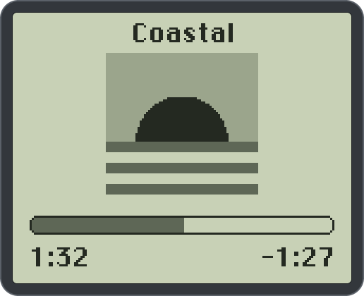
  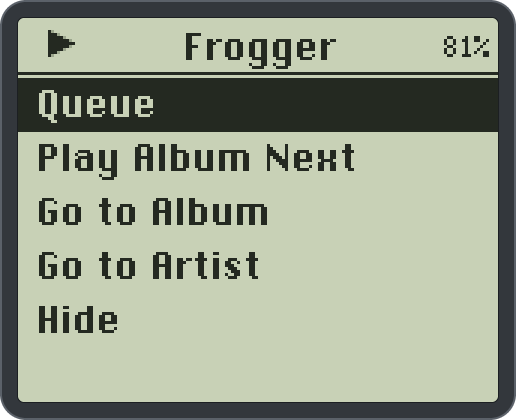
  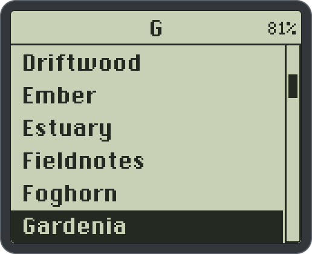

## Features

Screenshots from the emulator, on a demo card of made-up music (`tools/emupod/screenshots.py` makes them).

### Now Playing

<table>
  <tr>
    <td align="center" valign="top" width="33%"> 
      <b>Cover page</b> Now Playing opens on the title, a 72×72 cover and the progress bar.</td>
    <td align="center" valign="top" width="33%">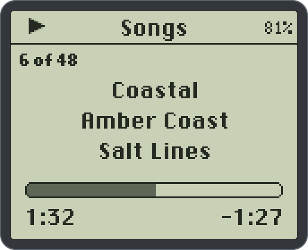 
      <b>Page slide</b> Select slides to Apple's page (scrubbing, rating), and it slides back.</td>
  </tr>
</table>

- **Resume mixes.** Songs of 20 minutes or longer start where you left them.
- **Skip counts.** Songs left within 2–20 s count as skipped, as in iTunes.

### Hold menu and Queue

<table>
  <tr>
    <td align="center" valign="top" width="33%">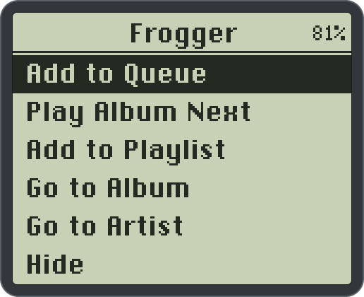 
      <b>Hold menu</b> Hold Select on a song, album, artist or playlist.</td>
    <td align="center" valign="top" width="33%"> 
      <b>On Now Playing</b> Hold Select there too. Queue shows when songs are waiting.</td>
    <td align="center" valign="top" width="33%">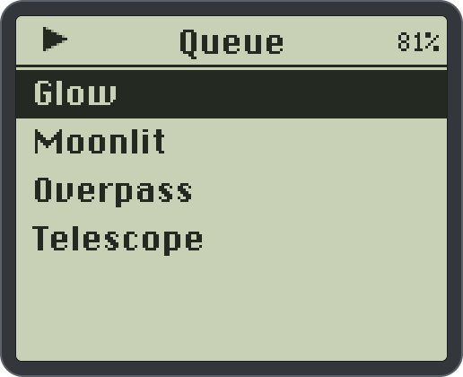 
      <b>Queue</b> Queued songs play next, then playback goes back to where it was.</td>
  </tr>
  <tr>
    <td align="center" valign="top" width="33%">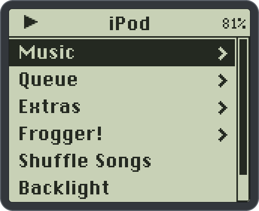 
      <b>On the main menu</b> The queue has a row there while songs wait.</td>
  </tr>
</table>

From the queue you can play a song, remove one or clear it.

### Browsing

<table>
  <tr>
    <td align="center" valign="top" width="33%"> 
      <b>Jump by letter</b> Spin the wheel fast in a long list and it moves a letter at a time.</td>
    <td align="center" valign="top" width="33%">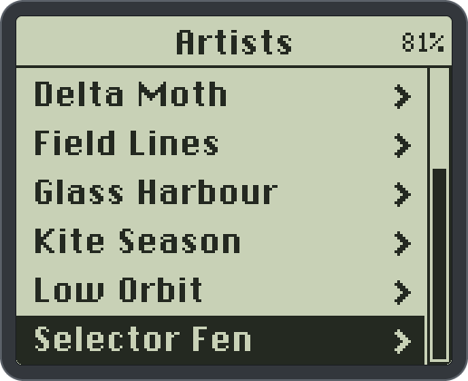 
      <b>Album artists</b> Compilations list under their album artist.</td>
    <td align="center" valign="top" width="33%">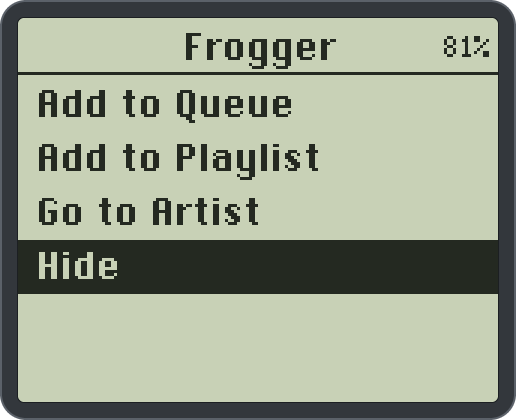 
      <b>Hidden songs</b> Hide an album, artist or song from the hold menu.</td>
  </tr>
</table>

Hidden songs stay out of Artists, Albums, Genres and Composers but still play from Songs and
playlists. Show un-hides them, and Settings › Show Hidden lists them again.

### Settings and status

<table>
  <tr>
    <td align="center" valign="top" width="33%">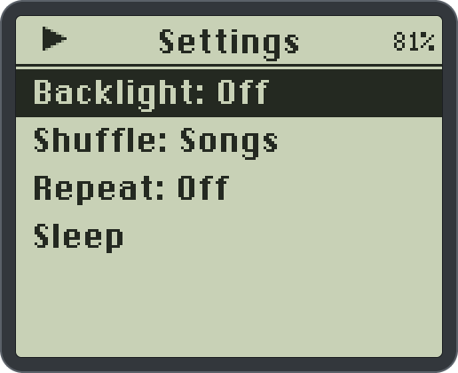 
      <b>Quick settings</b> Hold Menu anywhere: Backlight, Shuffle, Repeat, Sleep.</td>
    <td align="center" valign="top" width="33%">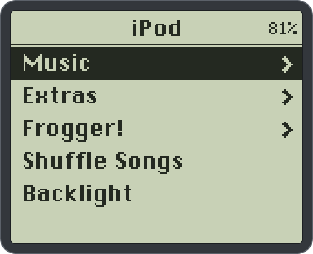 
      <b>Battery percentage</b> In the title bar, in place of the bars.</td>
    <td align="center" valign="top" width="33%">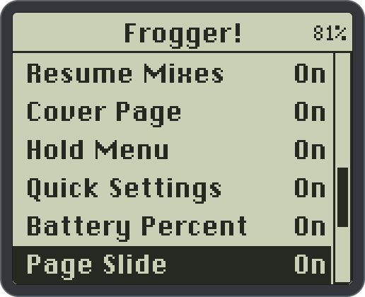 
      <b>Switches</b> Turn off the features you don't want.</td>
  </tr>
</table>

- **Disk recovery.** On a flash mod (an SD or CF adapter), the card can stop answering after a
  dip in the supply voltage. Apple's firmware then plays what's in memory and stops until a
  restart. Frogger resets the card and tries the read again, so the music plays on. Covers load
  on a task of their own, so the menus keep working while it does.

Settings has a switch for the ones you might not want: Cover Page, Hold Menu, Quick Settings,
Battery Percent, Page Slide, Jump by Letter, Resume Mixes (all on), and Show Hidden (off). Off is
Apple's behaviour again, from the next time the feature runs. How each feature works:
`docs/re-notes.md`, `docs/nowplaying.md`, `docs/tcmd.md`, and for the disk
`docs/power-and-emupod.md`.

## Install

You need:

- A 3rd generation iPod on Apple's firmware 2.3, the last one for the 3G (in `iPod_2.2.3.ipsw`).
- A Mac, Linux or Windows computer, and Python 3.
- Frogger's tools: [download this repo](https://github.com/jrvgr/frogger/archive/refs/heads/main.zip)
  or `git clone` it.
- `frogger-loader.bin` from the latest [release](https://github.com/jrvgr/frogger/releases).
  `SHA256SUMS` next to it has its checksum (`shasum -a 256 -c SHA256SUMS`; `sha256sum -c` on
  Linux, `Get-FileHash` on Windows).

Frogger takes the top 1 MiB of the iPod's 32 MiB of RAM for itself. That comes out of the
song cache, so a hard drive spins up a little more often and the battery runs down a little
sooner. A flash mod (a CF or SD card in place of the drive) is recommended for that reason.

Put the iPod in disk mode and find its disk, then run this from the repo's folder.

macOS: `diskutil list` shows it (say `/dev/disk4`).

    diskutil unmountDisk /dev/disk4
    sudo python3 tools/install.py disk-install /dev/rdisk4 frogger-loader.bin --backup-dir backups

Linux: `lsblk` shows it (say `/dev/sdb`, with the music on `/dev/sdb2`).

    sudo umount /dev/sdb2
    sudo python3 tools/install.py disk-install /dev/sdb frogger-loader.bin --backup-dir backups

Windows: in a terminal opened with **Run as administrator**, `Get-Disk` (or `diskpart`, then
`list disk`) shows its number N. install.py dismounts the iPod's drive letter while it writes.

    py tools\install.py disk-install \\.\PhysicalDriveN frogger-loader.bin --backup-dir backups

`disk-status` (same disk argument) says whether Frogger is on it. It only takes a disk whose
firmware partition is Apple's 2.3, so a wrong disk number is refused before anything is written.

It saves the whole firmware partition to `backups/` before it changes anything. Keep a copy of
that file somewhere else too. Restart the iPod (hold Menu + Play). The main menu says
"Frogger!" instead of "Settings" when Frogger is running.

`frogger-loader-debug.bin` is the same with a crash recorder: after a crash, the next boot
writes `iPod_Control/iTunes/FroggerDebug`. Attach it to a bug report.

To build the loader yourself, see [CONTRIBUTING.md](CONTRIBUTING.md#building).

## Getting back to stock

- Hold **Menu** while the iPod starts: stock firmware, nothing patched.
- `sudo python3 tools/install.py disk-remove /dev/rdiskN --backup-dir backups`: take Frogger out.
- `sudo python3 tools/install.py disk-restore /dev/rdiskN backups/FILE`: put a saved firmware
  partition back, byte for byte.
- On Linux the disk is `/dev/sdX`; on Windows, `py tools\install.py ... \\.\PhysicalDriveN` from
  an Administrator terminal, without sudo.
- [docs/recovery.md](docs/recovery.md) has disk mode and the rest.

## Without Crate

Crate writes the covers, sets the hide flag and reads back what the iPod recorded (hides,
skips, songs added to playlists, mix positions) when it syncs. Until it's out,
`tools/podinfo.py` shows that data and sets the flag (plain Python 3, iPod mounted; on Linux
it's where it's mounted, say `/media/$USER/IPOD`, on Windows its drive letter, `py tools\podinfo.py E:\`):

    tools/podinfo.py /Volumes/IPOD                # summary
    tools/podinfo.py /Volumes/IPOD hidden         # also: skips, playlists, bookmarks, tracks
    tools/podinfo.py /Volumes/IPOD hide 1234      # hide track id 1234 (unhide to undo)

`tools/coverart.py /Volumes/IPOD` writes the covers (FroggerArt) from the pictures in the
songs, your music folders (`--library`) or pictures you pick (`--map`); it needs Pillow, which
`nix develop` has (or `uv run tools/coverart.py ...` fetches it). Run it after every sync.
Without FroggerArt the cover page shows a frog instead of covers. Any other syncing app writes a
new database, and the iPod then ignores Frogger's files from before it.

## Contributing

Bugs, ideas and fixes are welcome: open an issue from one of the forms. Building, the tests and
how the code is laid out are in [CONTRIBUTING.md](CONTRIBUTING.md).

## License

MIT, see [LICENSE](LICENSE). It covers Frogger's own code, and every earlier version of it,
including commits from before the LICENSE file was added. Apple's firmware isn't part of it and
isn't in the repo. emupod (`third_party/emupod`) is MIT too.
